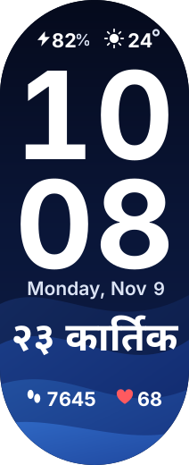
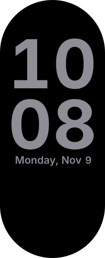

# Glass Lock

A minimal phone-lock-screen style face for Xiaomi Smart Band 10, sized for legibility on the 1.72" screen.

| Active display | Always-on display |
|---|---|
|  |  |

## Contents

- battery % and weather icon + temperature on the top row;
- giant stacked hour/minute clock;
- English date (`Monday, Nov 9`) built from weekday, month, and day widgets;
- large Nepali (Bikram Sambat) date, e.g. `२३ कार्तिक`;
- steps and heart rate;
- layered blue wave wallpaper; AOD shows only the dimmed clock and date.

## Nepali date

The firmware has no Bikram Sambat data source, so the generator pre-renders one BS date image per day of the **current AD month**, keyed by the `day` source. Regenerate and reinstall at the start of every month:

```sh
npm run package:glass
```

Set `GLASS_AD_MONTH=2026-12` to build for a different month ahead of time.

## Build

```sh
npm run generate:glass
npm run validate:glass
npm run build:glass
npm run package:glass
npm run inspect:glass
npm run screenshots:glass
npm run preview:glass
```

Text is rasterized at build time from macOS system fonts (Helvetica Neue, Kohinoor Devanagari); other systems fall back to their default fonts.

Earlier revisions were installed on a physical Band 10 via the Notify app; verify each rebuild on your own band.

## Install

Copy `dist/glass-lock.face` to an Android phone and install it with Notify for Xiaomi. Step-by-step guide (including iPhone-paired bands): [docs/installation.md](../../docs/installation.md#notify-for-xiaomi-route).
